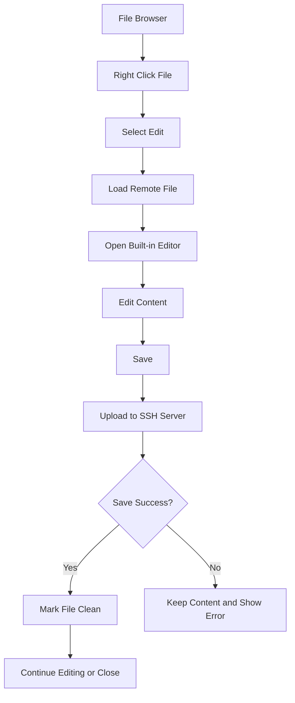
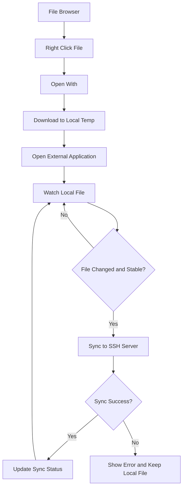
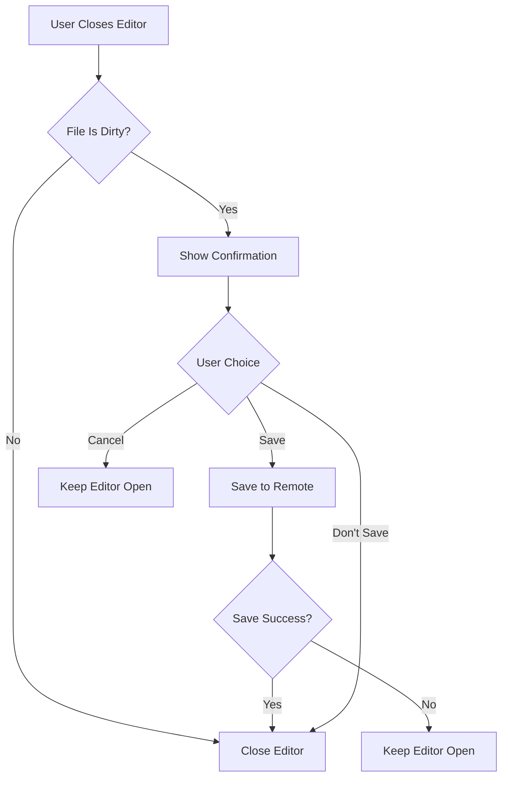

# Enhancement: Edit File – Chỉnh sửa file trực tiếp qua SSH

**Project:** HeroTerm  
**Type:** Enhancement  
**Priority:** P0 – MVP (External Editor: P1)

## 1. Mục tiêu

Phát triển tính năng cho phép người dùng chỉnh sửa trực tiếp file trên SSH Server thông qua HeroTerm mà không cần thao tác tải file về và upload thủ công.

Người dùng có thể lựa chọn một trong hai phương thức:

1. **Built-in Editor:** Chỉnh sửa file bằng trình editor tích hợp trong HeroTerm.
2. **External Editor:** Mở file bằng ứng dụng trên macOS do người dùng lựa chọn, ví dụ Visual Studio Code, Sublime Text hoặc TextEdit.

## 2. Phạm vi chức năng

### 2.1. Edit file từ File Browser

Khi click chuột phải vào một file trong File Browser (SFTP), hiển thị các tùy chọn:

- **Edit:** Mở file bằng Built-in Editor.
- **Open With:** Mở file bằng ứng dụng bên ngoài trên macOS.
- **Download:** Tải file về máy.
- **Rename:** Đổi tên file.
- **Delete:** Xóa file.

Chỉ bật chức năng Edit đối với các định dạng có thể xử lý dưới dạng nội dung văn bản. Với file nhị phân hoặc file vượt giới hạn hỗ trợ, hiển thị thông báo phù hợp.

### 2.2. Built-in Editor

Phát triển trình chỉnh sửa file tích hợp trực tiếp trong HeroTerm.

**Giao diện và hành vi:**

- Mở editor trong một tab mới tại khu vực làm việc chính.
- Hiển thị tên file và đường dẫn đầy đủ.
- Hỗ trợ mở nhiều file cùng lúc, mỗi file tương ứng một tab.
- Hiển thị trạng thái file đã thay đổi (Dirty) hoặc chưa thay đổi (Clean).
- Có chỉ báo file chưa lưu trên tab.
- Hỗ trợ các thao tác cơ bản:
  - Undo / Redo.
  - Find / Replace.
  - Select All.
  - Copy / Paste.
  - Indentation.
  - Hiển thị số dòng.
  - Syntax Highlighting theo định dạng file.

**Các định dạng ưu tiên:**

| Nhóm | Định dạng |
|---|---|
| Config | `.env`, `.ini`, `.conf`, `.yaml`, `.yml`, `.json`, `.xml` |
| Programming | `.php`, `.js`, `.ts`, `.vue`, `.dart`, `.py`, `.go` |
| Web | `.html`, `.css`, `.scss`, `.md` |
| Shell | `.sh`, `.bash`, `.zsh` |
| Database | `.sql` |
| Text | `.txt`, `.log` |

### 2.3. External Editor – Mở bằng ứng dụng macOS

Cho phép người dùng chọn ứng dụng macOS để chỉnh sửa file.

**Yêu cầu:**

- Cho phép chọn ứng dụng mặc định để mở file.
- Cho phép thay đổi ứng dụng mặc định trong Settings.
- Nếu chưa cấu hình, hiển thị danh sách ứng dụng khả dụng hoặc hộp thoại chọn ứng dụng.
- Có thể hỗ trợ cấu hình ứng dụng theo loại file nếu phù hợp.

**Cơ chế hoạt động:**

Không mở trực tiếp đường dẫn SSH bằng ứng dụng macOS. HeroTerm cần:

1. Tải file remote về thư mục tạm local.
2. Mở file local bằng ứng dụng được chọn.
3. Theo dõi thay đổi của file local.
4. Khi file local thay đổi và được lưu, đồng bộ nội dung mới lên SSH Server.
5. Hiển thị trạng thái đồng bộ thành công hoặc thất bại.
6. Dọn dẹp file tạm khi người dùng đóng phiên chỉnh sửa, theo chính sách an toàn dữ liệu.

Không tự động upload khi file đang được ứng dụng bên ngoài ghi dở. Cần debounce việc phát hiện thay đổi và chỉ đồng bộ sau khi file ổn định hoặc ứng dụng đã hoàn tất thao tác ghi.

### 2.4. Save / Don't Save / Cancel khi đóng Editor

Khi người dùng chỉnh sửa nội dung file và thực hiện đóng tab hoặc thao tác có thể làm mất nội dung chưa lưu, hiển thị dialog xác nhận.

**Nội dung đề xuất:**

**Unsaved Changes**

File đã có thay đổi chưa được lưu. Bạn có muốn lưu các thay đổi này không?

Các lựa chọn:

- **Save:** Lưu nội dung mới lên SSH Server. Chỉ đóng editor sau khi lưu thành công.
- **Don't Save:** Bỏ các thay đổi chưa lưu và tiếp tục đóng editor.
- **Cancel:** Hủy thao tác đóng editor, giữ nguyên nội dung đang chỉnh sửa.

**Quy tắc:**

- Chỉ hiển thị dialog khi file có thay đổi chưa được lưu.
- Nếu lưu thành công, cập nhật trạng thái file thành Clean.
- Nếu lưu thất bại, giữ nguyên nội dung editor và hiển thị lỗi; không đóng editor.
- Nếu người dùng chọn Cancel, giữ nguyên tab và nội dung.
- Không nhầm lẫn xác nhận đóng file chưa lưu với xác nhận trước khi upload file.

### 2.5. Smart Save Confirmation – Ghi nhớ lựa chọn lưu file

Giảm thao tác xác nhận đối với file mà người dùng thường xuyên chỉnh sửa.

**Logic đề xuất:**

- Theo dõi số lần lưu thành công liên tiếp của từng file.
- Khi người dùng lưu thành công cùng một file đủ 3 lần, hiển thị dialog hỏi có muốn bỏ qua bước xác nhận lưu cho file đó hay không.
- Các lựa chọn:
  - **Continue Asking:** Tiếp tục hỏi xác nhận.
  - **Don't Ask Again for This File:** Không hỏi xác nhận lưu cho file này nữa.
- Ghi nhớ lựa chọn theo SSH Profile và đường dẫn file remote.
- Cho phép người dùng thay đổi hoặc khôi phục thiết lập trong Settings.
- Chỉ tăng bộ đếm khi thao tác lưu thành công.
- Nếu thao tác lưu thất bại, không tăng bộ đếm.

**Lưu ý về an toàn dữ liệu:**

Cần phân biệt hai loại xác nhận:

1. **Save confirmation:** Xác nhận trước khi thực hiện thao tác lưu, nếu có áp dụng.
2. **Unsaved changes confirmation:** Cảnh báo khi đóng file hoặc rời khỏi editor trong lúc còn thay đổi chưa lưu.

Việc chọn “Don't Ask Again” chỉ bỏ qua loại xác nhận lưu đã được người dùng cho phép bỏ qua; không được tự ý bỏ cảnh báo mất dữ liệu khi đóng file chưa lưu.

### 2.6. Settings – File Editor

Bổ sung nhóm cấu hình `File Editor`:

| Setting | Mô tả |
|---|---|
| Default Editor | Built-in Editor hoặc External Editor |
| External Application | Ứng dụng macOS mặc định |
| Auto Sync | Tự động đồng bộ thay đổi từ External Editor lên SSH Server |
| Save Confirmation | Cấu hình xác nhận trước khi lưu (nếu có) |
| Smart Save | Bật/tắt tính năng ghi nhớ lựa chọn sau 3 lần lưu |
| Temp Directory | Thư mục local dùng để lưu file tạm |

Cần có khu vực quản lý các file đã chọn “Don't Ask Again”, cho phép bật lại xác nhận lưu.

## 3. Luồng hoạt động

### 3.1. Built-in Editor

### 3.2. External Editor

### 3.3. Đóng file chưa lưu

## 4. Yêu cầu kỹ thuật

- Sử dụng SFTP để tải và upload file.
- Quản lý trạng thái Dirty / Clean cho từng file đang mở.
- Hỗ trợ UTF-8; xử lý encoding không hỗ trợ một cách an toàn, không tự ý làm hỏng nội dung.
- Có giới hạn kích thước file có thể mở trong Built-in Editor và cấu hình giới hạn hợp lý.
- Kiểm tra file remote có bị thay đổi bởi tiến trình hoặc người dùng khác trước khi ghi đè.
- Sử dụng cơ chế kiểm tra phiên bản, modification time, size hoặc checksum phù hợp để phát hiện xung đột.
- Khi phát hiện xung đột, không ghi đè âm thầm; thông báo người dùng và cung cấp lựa chọn xử lý.
- Khi upload thất bại, giữ nội dung local/editor để người dùng có thể thử lại.
- External Editor cần có file watcher, debounce và cơ chế tránh upload lặp khi ứng dụng ghi file nhiều lần.
- Có cơ chế cleanup file tạm nhưng không xóa file khi vẫn còn thay đổi chưa đồng bộ.
- Không ghi log nội dung file, đặc biệt với `.env`, private key và file cấu hình chứa credentials.
- Bảo vệ file tạm local phù hợp; tránh để lộ dữ liệu nhạy cảm.
- Xử lý trường hợp mất kết nối SSH trong lúc lưu hoặc đồng bộ.

## 5. Acceptance Criteria

### File Browser

- [ ] Có tùy chọn Edit trong context menu của file.
- [ ] Có tùy chọn Open With để mở bằng ứng dụng macOS.
- [ ] Không cho phép mở file không phù hợp; hiển thị thông báo rõ ràng.

### Built-in Editor

- [ ] Có thể mở và chỉnh sửa file bằng Built-in Editor.
- [ ] Có thể mở nhiều file trong nhiều tab.
- [ ] Hiển thị tên, đường dẫn và trạng thái Dirty / Clean.
- [ ] Có Syntax Highlighting cho các định dạng được hỗ trợ.
- [ ] Có thể Save nội dung lên SSH Server.
- [ ] Lưu thất bại không làm mất nội dung đang chỉnh sửa.

### Save Confirmation

- [ ] Có dialog Save / Don't Save / Cancel khi đóng file chưa lưu.
- [ ] Save chỉ đóng editor khi lưu thành công.
- [ ] Don't Save đóng editor và bỏ thay đổi chưa lưu sau khi người dùng xác nhận.
- [ ] Cancel giữ nguyên editor và nội dung.

### Smart Save Confirmation

- [ ] Theo dõi số lần lưu thành công liên tiếp theo từng file.
- [ ] Sau 3 lần lưu thành công, hiển thị tùy chọn ghi nhớ.
- [ ] Có thể chọn tiếp tục hỏi hoặc không hỏi xác nhận lưu cho file đó.
- [ ] Lựa chọn được lưu theo SSH Profile và đường dẫn file.
- [ ] Có thể thay đổi lựa chọn trong Settings.
- [ ] Không bỏ qua cảnh báo khi đóng file còn thay đổi chưa lưu.

### External Editor

- [ ] Có thể chọn ứng dụng macOS để mở file.
- [ ] Có thể cấu hình ứng dụng mặc định trong Settings.
- [ ] File được tải về local trước khi mở.
- [ ] Có thể phát hiện thay đổi từ ứng dụng bên ngoài.
- [ ] Nội dung thay đổi được đồng bộ lên SSH Server.
- [ ] Khi đồng bộ thất bại, giữ lại file local và thông báo lỗi.
- [ ] Phát hiện và xử lý xung đột khi file remote thay đổi đồng thời.

## 6. Phân chia giai đoạn phát triển

| Phase | Nội dung | Priority |
|---|---|---|
| Phase 1 | Built-in Editor, mở file, chỉnh sửa, Save | P0 |
| Phase 2 | Dirty State và dialog Save / Don't Save / Cancel | P0 |
| Phase 3 | Smart Save Confirmation sau 3 lần lưu | P1 |
| Phase 4 | External Editor trên macOS | P1 |
| Phase 5 | Auto Sync, Conflict Detection và Settings | P1 |

## 7. Định hướng triển khai

Nên ưu tiên Built-in Editor trước để hoàn thiện quy trình đọc, chỉnh sửa và lưu file qua SFTP. Sau đó phát triển External Editor dựa trên cơ chế local temporary workspace và file watcher để đồng bộ thay đổi về remote server.

Đối với External Editor, cần đặc biệt chú ý xử lý xung đột dữ liệu và không tự động ghi đè file remote khi chưa xác định được file có bị thay đổi đồng thời hay không.
